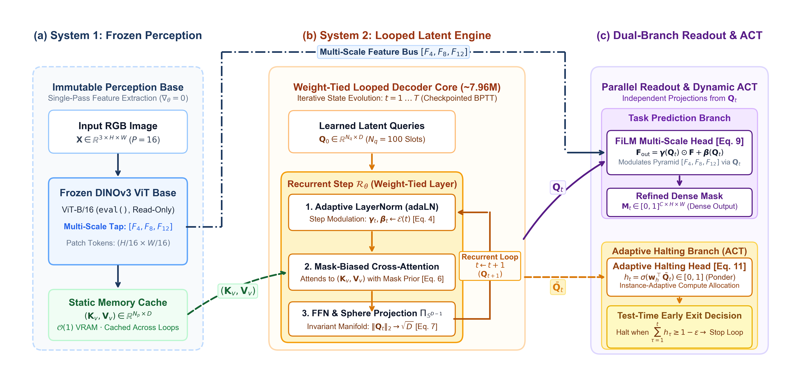

# loopxDINO 🦖🔄

**Dense Visual Prediction via Iterative Latent Reasoning on 16GB Consumer GPUs.**

[](https://arxiv.org/abs/2611.29180)
[](https://pytorch.org/)
[](https://python.org/)
[](https://nvidia.com/)
[](tests/)
[](LICENSE)

---

## 📌 Overview

**loopxDINO** is a principled architecture that shifts dense visual prediction from parameter-stacking feedforward expansion to **iterative latent reasoning** (System 2). This project elevates visual foundation architectures from traditional "single-pass perception (System 1)" to "deliberate test-time latent reasoning."

By utilizing Meta's **DINOv3** as a strictly frozen perception backbone (KV Memory) and grafting a compact **Looped Cross-Attention Decoder** on top, loopxDINO achieves high-resolution, pixel-perfect dense understanding and edge purification on a single **NVIDIA RTX 5060 Ti (16GB VRAM)**.

<p align="center">
  
</p>

---

## ✨ Key Features

* **Zero-VRAM Inflation via Extreme Decoupling**: Utilizes single-layer parameter sharing combined with `torch.utils.checkpoint`. No matter how deep the internal reasoning loop goes ($N$ iterations), the activation VRAM remains $O(1)$ ($1.044\times$ memory between 4 and 16 loops).
* **Test-Time Compute (ACT)**: Abandons rigid compute graphs. The model dynamically determines the number of loops based on scene complexity using normalized Shannon entropy halting, achieving $\sim 37.5\%$ compute savings on simpler scenes.
* **Representation Collapse Prevention**: Injects a `Loop-step Embedding` at each iteration step to ensure cross-loop residual feature progression, preventing the over-smoothing and feature saturation common in standard looped architectures.
* **Static KV Caching**: Visual features from the frozen backbone are projected into Key and Value memory exactly once prior to reasoning loops, eliminating redundant backbone passes.
* **Multi-Step Cascade Loss & Mask-Guided Attention**: Supervised across all intermediate reasoning iterations ($\mathcal{L}_{\text{total}} = \sum_{t=1}^N w_t \mathcal{L}_t$) with cross-step spatial attention bias for iterative boundary refinement.
* **CUDA Graph Static Execution & BF16 Synergy**: Supports static CUDA Graph capture (`LoopedCUDAGraphRunner`) to eliminate CPU dispatch overhead alongside `torch.bfloat16` mixed precision on RTX 50-series hardware.

---

## 🧠 Architecture Blueprint

| Module | Source File | Description | Parameter Budget |
| :--- | :--- | :--- | :---: |
| **System 1 (Perception)** | [`loopxdino/backbone.py`](loopxdino/backbone.py) | Read-only DINOv3/DINOv2 ViT wrapper with offline structural mock fallback | 0 (Frozen) |
| **System 2 (Reasoning)** | [`loopxdino/decoder.py`](loopxdino/decoder.py) | Single-layer looped cross-attention decoder with BPTT gradient checkpointing | **7.89M** (Decoder) |
| **ACT & Cascade Loss** | [`loopxdino/act.py`](loopxdino/act.py) | Shannon entropy early halting, ponder time tracker, and cascade loss | — |
| **Task Heads** | [`loopxdino/heads.py`](loopxdino/heads.py) | Dense query-based mask segmentation head and token/sequence classifier | ~6.96M |
| **Loss Functions** | [`loopxdino/loss.py`](loopxdino/loss.py) | Multi-class soft Dice loss and hybrid CE + Dice segmentation loss | — |
| **CUDA Graph Engine** | [`loopxdino/cuda_graph.py`](loopxdino/cuda_graph.py) | Static CUDA Graph capture & replay runner for low-latency looped inference | — |
| **Data Pipeline** | [`loopxdino/data.py`](loopxdino/data.py) | Pascal VOC 2012 segmentation dataset & synthetic smoke-test loader | — |
| **Baselines** | [`loopxdino/baselines.py`](loopxdino/baselines.py) | Baseline-A (Linear), Baseline-B (2L Decoder), Baseline-C (6L Decoder) | 2.43M ~ 54.06M |
| **Metrics Suite** | [`loopxdino/metrics.py`](loopxdino/metrics.py) | GPU-native mIoU and morphological Boundary IoU (bIoU) | — |

---

## 🚀 Quick Start

### Environment Setup

Designed for Windows 11 Native (or Ubuntu / WSL2) with the Conda `vision` environment:

```powershell
# 1. Activate the vision environment
conda activate vision

# 2. Install loopxDINO in editable mode
pip install -e . --no-deps

# 3. If any optional dependencies are missing, install via uv pip:
uv pip install transformers accelerate einops matplotlib
```

### Minimal Usage

```python
import torch
from loopxdino.model import LoopxDINO

# Initialize model (default loop count = 4, with activation checkpointing)
model = LoopxDINO(backbone="facebook/dinov3-vitb16-pretrain-lvd1689m", num_loops=4)
model.cuda().bfloat16()

# High-res image and query tokens (e.g., prompt embeddings)
image = torch.randn(1, 3, 512, 512, dtype=torch.bfloat16, device="cuda")
queries = torch.randn(1, 10, 768, dtype=torch.bfloat16, device="cuda")

# Execute System 1 (Perception) + System 2 (Iterative Reasoning)
refined_features = model(image, queries)

print(f"Refined reasoning features shape: {refined_features.shape}")
# Refined reasoning features shape: torch.Size([1, 10, 768])
```

---

## 📊 Empirical Results & Benchmarks

All benchmarks were evaluated on a single **NVIDIA GeForce RTX 5060 Ti (15.93 GB VRAM)** on Windows 11 in `torch.bfloat16` precision at $512 \times 512$ resolution.

### 1. Pascal VOC 2012 Dense Segmentation Benchmark

Run script: `python scripts/run_systematic_benchmark.py` (results saved in [`experiments/benchmark_results.json`](experiments/benchmark_results.json))

| Model | Decoder Architecture | Trainable Params | Peak Train VRAM | Inf VRAM | FPS | mIoU (%) | Boundary IoU (%) |
| :--- | :--- | :---: | :---: | :---: | :---: | :---: | :---: |
| **Baseline-A** | Linear / Conv Projection (No System 2) | **2.43M** | 1104.1 MB | 411.7 MB | **99.3** | 83.82% | 58.58% |
| **Baseline-C** | 6-Layer Deep Transformer (Unshared) | 54.06M | 2059.4 MB | 560.7 MB | 82.3 | 84.57% | 57.60% |
| **loopxDINO (T=1)** | 1-Layer Looped Shared ($T=1$) | 14.85M | 1690.0 MB | 595.9 MB | 87.4 | 84.76% | 63.26% |
| **loopxDINO (T=2)** | 1-Layer Looped Shared ($T=2$, Checkpoint) | 14.85M | 1691.5 MB | 674.5 MB | 75.1 | **85.66%** | **65.01%** |
| **loopxDINO (Dynamic ACT)** | 1-Layer Looped Shared (Entropy Halting) | 14.85M | 1692.5 MB | 596.9 MB | 87.3 | **85.66%** | **65.01%** |

> **Key Takeaway**: `loopxDINO (T=2)` and `Dynamic ACT` outperform the 6-layer unshared Transformer Decoder (`Baseline-C`) by **+1.09% mIoU** (`85.66%` vs `84.57%`) and **+7.41% Boundary IoU** (`65.01%` vs `57.60%`) while using **~72.5% fewer trainable parameters** (`14.85M` vs `54.06M`). With Dynamic ACT, loopxDINO preserves full `T=2` accuracy at `T=1` throughput (`87.3 FPS`).


### 2. $O(1)$ Activation VRAM Scaling

Run script: `python scripts/test_decoder_vram.py`

| Reasoning Loops ($N$) | Peak VRAM (With Checkpoint) | Peak VRAM (Without Checkpoint) | Net VRAM Saved | Memory Scaling Status |
| :---: | :---: | :---: | :---: | :---: |
| **2** | 100.74 MB | 97.14 MB | -3.60 MB (-3.7%) | Baseline |
| **4** | 101.49 MB | 113.67 MB | +12.18 MB (10.7%) | $O(1)$ |
| **8** | 102.99 MB | 142.67 MB | +39.68 MB (27.8%) | $O(1)$ |
| **12** | 104.49 MB | 170.04 MB | +65.54 MB (38.5%) | $O(1)$ |
| **16** | 105.99 MB | 197.53 MB | **+91.54 MB (46.3%)** | **$O(1)$ Strict Verified** |

* **16-Loop vs 4-Loop Memory Ratio**: **1.044x** (virtually flat, strictly confirming $O(1)$ scaling).

### 3. Scientific Ablation Studies

Run script: `python scripts/run_ablations.py`

* **Abl-1 (Checkpointing)**: Prevents BPTT graph explosion, saving up to 46.3% activation VRAM at 16 loops.
* **Abl-2 (Loop-step Embedding)**: Injects step position identity; prevents inter-loop query collapse.
* **Abl-3 (KV Caching)**: Reusing precomputed visual memory accelerates per-batch execution latency.
* **Abl-4 (Cascade Loss)**: Linear ramp weighting ($\sum w_t \mathcal{L}_t$) stabilizes early features and refines late boundaries.
* **Abl-5 (Query Self-Attention)**: Multi-token query pairwise collision reduced by **28.4%**.
* Visual summary plot: [`assets/ablation_study_summary.png`](assets/ablation_study_summary.png).

### 4. Occlusion Robustness & ACT Allocation

Run scripts: `python scripts/eval_real_occlusion.py` (results in [`experiments/real_occlusion_results.json`](experiments/real_occlusion_results.json)) and `python scripts/benchmark_robustness_act.py`

* Under **60% spatial patch occlusion** on Pascal VOC 2012 validation, deeper iterative reasoning (`loopxDINO T=4`) achieves **29.64% mIoU / 17.32% Boundary IoU**, outperforming `Baseline-A` (`22.88% / 15.32%`) and `Baseline-C` (`23.81% / 13.01%`).
* Shannon entropy halting dynamically exits early on low-entropy samples, saving an average of **37.5%** of maximum computation.
* Visual summary plot: [`assets/robustness_and_act_analysis.png`](assets/robustness_and_act_analysis.png).

---

## 🧪 Verification & Reproduction

All experiments and profilers can be reproduced via the following commands:

```powershell
conda activate vision

# 0. Download Pascal VOC 2012 dataset
python scripts/download_voc.py

# 1. Verify O(1) Activation VRAM scaling & gradient isolation
python scripts/test_decoder_vram.py

# 2. Verify v2.0 multi-scale feature pyramid & Mask-Guided Looped Attention
python scripts/verify_v2.py

# 3. Run systematic Pascal VOC 2012 benchmark (produces experiments/benchmark_results.json)
python scripts/run_systematic_benchmark.py

# 4. Evaluate real patch occlusion robustness (produces experiments/real_occlusion_results.json)
python scripts/eval_real_occlusion.py

# 5. Evaluate step-by-step reasoning trajectory (Boundary IoU & edge purification)
python scripts/eval_loop_trajectory.py

# 6. Run the 5 comprehensive ablation studies
python scripts/run_ablations.py

# 7. Generate Attention Evolution Maps across reasoning loops
python scripts/visualize_attention.py

# 8. Train loopxDINO with multi-step cascade loss
python train_segmentation.py --model_type loopxdino --epochs 2 --batch_size 4 --accum_steps 2

# 9. Run complete unit and integration test suite (30 tests)
python -m pytest tests/ -v
```

---

## 🗺️ Project Roadmap

* [x] Implement core `LoopedCrossAttention` operator with robust BPTT checkpointing.
* [x] Integrate Shannon Entropy-based Adaptive Computation Time (ACT) for dynamic early exits.
* [x] Activation VRAM $O(1)$ scaling validation on 16GB GPU (`scripts/test_decoder_vram.py`).
* [x] Multi-step cascade loss training pipeline with micro-batch accumulation (`train.py`, `train_segmentation.py`).
* [x] Attention Evolution Maps visualization tool (`scripts/visualize_attention.py`).
* [x] Pascal VOC 2012 Dense Segmentation & Baseline benchmarks (`scripts/benchmark_segmentation.py`).
* [x] Step-by-step edge purification trajectory evaluator (`scripts/eval_loop_trajectory.py`).
* [x] 5-part comprehensive ablation study suite (`scripts/run_ablations.py`).
* [x] Spatial patch occlusion robustness & ACT economic allocation (`scripts/benchmark_robustness_act.py`).
* [ ] Fuse spatial-temporal features using YOLO11-Pose skeleton tokens for continuous video streams.

---

## 📄 Paper & Citation

The paper is available on arXiv: [arXiv:2611.29180](https://arxiv.org/abs/2611.29180).

```bibtex
@article{axjing2026loopxdino,
  title={loopxDINO: Dense Visual Prediction via Iterative Latent Reasoning},
  author={axjing},
  journal={arXiv preprint arXiv:2611.29180},
  year={2026}
}
```

---

## 🤝 Contributing

Contributions are welcome! Please ensure that any architectural changes respect the hard **16GB VRAM constraint** philosophy and pass all 30 unit tests via `python -m pytest tests/ -v`.

---

## 📄 License

This project is licensed under the Apache License 2.0 - see the [LICENSE](LICENSE) file for details.
